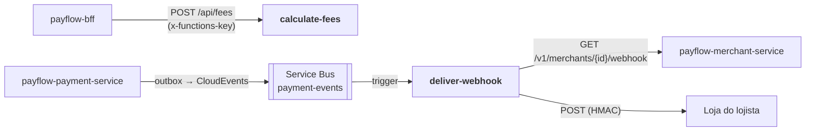

# payflow-functions

**Componente serverless do PayFlow**: uma Function App do **Azure Functions** com
duas funções, uma com **HTTP Trigger** e outra com **Message Trigger** (Service Bus).

Parte da plataforma PayFlow (arc42 completo no repositório de documentação
[`PayFlow`](https://github.com/CaioSeniuk/PayFlow)). Alunos: **Caio Henrique,
Gabriel Moribe, Guilherme Celente e Leonardo Berlanda** — PUCPR, Arquitetura de
Soluções com Cloud, 2026.

## O que é este repositório

| Função | Gatilho | O que faz |
|---|---|---|
| `calculate-fees` | **HTTP Trigger** (`POST /api/fees`) | **Cálculo/enriquecimento**: recebe totais por meio de pagamento e devolve taxa (MDR), valor líquido e data prevista de liquidação. É chamada pelo BFF em `/aggregated-data`. |
| `deliver-webhook` | **Service Bus Trigger** (fila `payment-events`) | **Consumidor da EDA**: para cada evento de pagamento, busca a configuração de webhook do lojista e envia o webhook assinado (HMAC-SHA256). Se falhar, a mensagem volta à fila; após 5 entregas, vai para a DLQ. |

Requisito da atividade atendido: _"Azure Function — HTTP Trigger / Message
Trigger, pode simular cálculo ou enriquecimento de dados, exposta via endpoint
HTTP"_. Esta Function App também substitui o antigo notification-service da
arquitetura aprovada.

## Relação com os outros repositórios



| Repositório | Relação |
|---|---|
| `payflow-bff` | Chama `calculate-fees` para compor `/aggregated-data`. |
| `payflow-payment-service` | Produz os eventos consumidos por `deliver-webhook`; o contrato está no `docs/asyncapi.yaml` dele. |
| `payflow-merchant-service` | Fornece URL, segredo e eventos do webhook do lojista. |

## Tecnologias

| Item | Escolha |
|---|---|
| Plataforma | Azure Functions v4, modelo de programação Node.js v4 |
| Runtime / linguagem | Node.js 22 (o mesmo do BFF), TypeScript, ESM |
| Validação | zod |
| Mensageria | Binding Service Bus (`app.serviceBusQueue`) |
| Assinatura | `node:crypto` HMAC-SHA256 |
| Testes | Vitest (unitários), dependency-cruiser (arquitetura) |
| Ferramentas locais | Azure Functions Core Tools v4, Azurite |
| Execução na nuvem | Function App `func-payflow` (Flex Consumption ou Consumption, Linux) |
| Observabilidade | Application Insights |

## Arquitetura interna (Clean Architecture + Vertical Slice)

| Camada | Pasta | Conteúdo |
|---|---|---|
| Domain | `src/domain/` | `calculateFees()` (regras de taxa puras), `signWebhook()` (HMAC, único uso de `node:crypto`), tipos `PaymentEvent`, erros |
| Application | `src/features/<fatia>/handler.ts`, `ports.ts` | Caso de uso e portas (`WebhookConfigProvider`, `WebhookSender`) |
| API | `src/features/<fatia>/function.ts` | Registro do gatilho (HTTP ou Service Bus) e tradução de entrada/saída |
| Infrastructure | `src/infrastructure/` | `HttpMerchantClient`, `FetchWebhookSender`, `loadConfig()` |
| Composição | `src/index.ts` (`main` do `package.json`) | Cria os adaptadores e registra as duas funções |

```text
src/
├── index.ts                 composição: adaptadores → portas, registro das funções
├── domain/
│   ├── errors.ts            DependencyUnavailableError, InvalidEventError
│   ├── fees.ts              taxas por método, calculateFees()
│   ├── payment-event.ts     PaymentEvent, WebhookSubscription
│   └── webhook-signature.ts signWebhook()
├── features/
│   ├── calculate-fees/      function.ts · handler.ts
│   └── deliver-webhook/     function.ts · handler.ts · ports.ts
└── infrastructure/
    ├── config.ts
    ├── fetch-webhook-sender.ts
    └── http-merchant-client.ts
test/                        domain · features · infrastructure (Vitest)
host.json
local.settings.example.json
```

As regras de dependência ficam em `.dependency-cruiser.cjs` e rodam no `npm test`:
domínio sem pacotes npm nem SDK do Azure, fatias independentes, fatias sem acesso a
`infrastructure` (recebem portas de `src/index.ts`) e `handler.ts`/`ports.ts` sem framework.

## Contratos

**`POST /api/fees`** (`authLevel: function`)

```json
// requisição
{ "byMethod": { "CARD": 90000, "PIX": 35000 }, "currency": "BRL" }
// resposta
{
  "totalFees": 3488,
  "netAmount": 121512,
  "byMethod": [
    { "method": "CARD", "gross": 90000, "rate": 0.0349, "fee": 3141, "settlement": "D+30" },
    { "method": "PIX",  "gross": 35000, "rate": 0.0099, "fee": 347,  "settlement": "D+0" }
  ]
}
```

Valores em centavos. As taxas são fictícias e ficam em `src/domain/fees.ts`. A taxa
de cada método é arredondada para o centavo mais próximo. Moeda diferente de `BRL`,
método desconhecido ou valor negativo/fracionário respondem `400` (Problem Details).

**`deliver-webhook`**: recebe um CloudEvent (`payment.*`) e envia `POST <url do lojista>`
com o corpo do evento e os cabeçalhos:

| Cabeçalho | Valor |
|---|---|
| `X-PayFlow-Event-Id` | `id` do evento (para idempotência na loja) |
| `X-PayFlow-Event-Type` | `type` do evento |
| `X-PayFlow-Signature` | `t=<unix>,v1=<hex HMAC-SHA256(segredo, "<t>.<corpo>")>` |

Resposta 2xx encerra a mensagem; outra resposta (inclusive redirecionamento, que não
é seguido) ou timeout (10 s) lança erro e o Service Bus reentrega; após 5 entregas a
mensagem vai para a DLQ. Falha do merchant-service também gera reentrega.

Descartados sem erro (mensagem concluída): lojista inexistente ou sem webhook (`404`
do merchant-service) e tipo de evento que o lojista não assinou. Mensagem que não é um
evento `payment.*` válido falha a execução e acaba na DLQ, onde pode ser inspecionada.

## Estado atual

- [x] Projeto Functions v4 TypeScript (modelo de programação v4, ESM)
- [x] `calculate-fees` + testes unitários do domínio e da função HTTP
- [x] `deliver-webhook` + testes unitários com portas simuladas e dos adaptadores HTTP
- [x] Regras dependency-cruiser no `npm test`
- [ ] Function App na Azure, App Settings e Application Insights
- [ ] Testar entrega com https://webhook.site e a DLQ com URL inválida
- [ ] GitHub Actions (build, testes e deploy)

## Como rodar localmente

Requer Node.js 22 e Azure Functions Core Tools v4. Para o `deliver-webhook`, o
Service Bus emulator (compose do payment-service) e o merchant-service rodando.

```bash
cp local.settings.example.json local.settings.json
npm install
npm test
npm start            # build + func start → http://localhost:7071/api/fees
```

Localmente, `authLevel: function` não exige a chave. Teste rápido:

```bash
curl -X POST http://localhost:7071/api/fees \
  -H 'content-type: application/json' \
  -d '{"byMethod":{"CARD":90000,"PIX":35000},"currency":"BRL"}'
```

### App Settings

| Variável | Descrição |
|---|---|
| `ServiceBusConnection` | Connection string com permissão `Listen` (segredo) |
| `SERVICEBUS_QUEUE` | `payment-events` |
| `MERCHANT_SERVICE_URL` | URL base do merchant-service |
| `INTERNAL_KEY` | `X-Internal-Key` do merchant-service (segredo, 32 a 256 caracteres) |
| `MERCHANT_SERVICE_TIMEOUT_MS` | Padrão `5000` |
| `WEBHOOK_TIMEOUT_MS` | Padrão `10000` |

As variáveis do `deliver-webhook` são lidas na primeira mensagem: se faltar alguma,
só essa função falha (mensagens vão para a DLQ) e o `calculate-fees` continua no ar.

## Publicação

```bash
npm run build
func azure functionapp publish func-payflow
```

A function key de `calculate-fees` (portal → Function → *Function Keys*) é
configurada no BFF como `FEES_FUNCTION_KEY`.

## Links

| Item | URL |
|---|---|
| `calculate-fees` | _a publicar_ |
| Documentação de arquitetura | https://github.com/CaioSeniuk/PayFlow |
